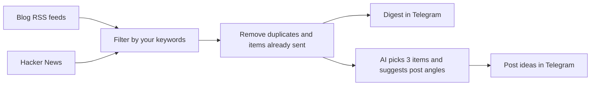

# Trend Radar

A daily news radar for marketers that also suggests what to write about. Every morning it reads the marketing and social media blogs you follow plus Hacker News, keeps only the items that match your keywords, removes duplicates, and sends two Telegram messages:

1. **Post ideas.** The AI picks the 3 most useful news items and gives 3 post angles for each (a hook and a one-line outline).
2. **The digest.** A short numbered list of all matching items with links.

It runs on GitHub Actions, so it works while your laptop is closed. The post ideas are optional: without an API key you still get the digest.



## Why this exists

A news digest alone leaves you with a question: now what? The radar goes one step further and turns today's news into post angles you can react to. The AI only sees titles and short snippets, so treat every angle as a starting point: read the article before you write about it.

## Set it up (about 20 minutes, no coding)

### 1. Create a Telegram bot
1. In Telegram, open **@BotFather** (check the blue verified tick), send `/newbot` and follow the steps. The display name can be anything, for example "Post Radar". You can change it later with `/setname`.
2. BotFather gives you a **token**. Treat it like a password.
3. Open your new bot, press Start and send it any message.
4. In a browser, open `https://api.telegram.org/bot<YOUR_TOKEN>/getUpdates` (replace `<YOUR_TOKEN>`). Find `"chat":{"id":` followed by a number. That number is your **chat id**.

### 2. Add the secrets to GitHub
In this repository: **Settings > Secrets and variables > Actions > New repository secret**.
- `TELEGRAM_BOT_TOKEN`: the token from BotFather
- `TELEGRAM_CHAT_ID`: the number from step 1
- `ANTHROPIC_API_KEY` (optional): turns on the post ideas. Create a key in the Anthropic Console. API use is billed separately from a Claude chat subscription, so set a spending limit and check current prices in the provider documentation.

Never put a token or key in a file in the repository.

### 3. Choose your sources and keywords
- `feeds.txt`: one RSS or Atom feed URL per line. Competitor blogs work well.
- `keywords.txt`: one keyword or phrase per line, in the language of your sources. Lines starting with `-` are exclusions.

### 4. Run it
Go to the **Actions** tab, open **Trend radar**, click **Run workflow**. After that it runs every day by itself (the time is set in `.github/workflows/radar.yml`, in UTC).

## No API key? Use any AI chat

```
python radar.py --print-prompt
```

This prints the instructions plus today's items. Paste the text into any AI chat and you get the same post ideas, with no key and no extra cost beyond your chat plan.

## Try it on your computer

```
python radar.py --demo                  # fictional sample feeds, no internet
python radar.py --demo --print-prompt   # also shows the AI prompt
python radar.py --dry-run               # real sources, prints instead of sending
python -m unittest                      # run the tests
```

Useful options: `--hours 24` (only items from the last 24 hours, default 48), `--max-items 5`, `--no-hn`, `--min-hn-points 10` (ignore weak Hacker News stories, default 5), `--no-ideas`, `--language English` (language of the ideas, default Ukrainian; also settable with the `IDEAS_LANGUAGE` environment variable), `--model` (or `IDEAS_MODEL`).

## How it works

1. Reads each feed (RSS or Atom). A broken feed is skipped with a warning.
2. Searches Hacker News for each keyword (public search API by Algolia). Only stories with the keyword in the title and at least 5 points are kept.
3. Keeps items that contain at least one keyword as a whole word and no exclusion word.
4. Removes duplicates (same link with tracking parameters, or the same title) and links sent in the last 30 days. The list is stored in `seen.json`, which the workflow commits back after each run.
5. If `ANTHROPIC_API_KEY` is set, sends the top 8 items (titles, sources and snippets cut to 300 characters) to the Anthropic API in one request per run and asks for 3 picks with 3 angles each. The prompt tells the AI to use only the given text and not to invent facts. If the call fails, the digest is still sent.

## What was tested, and what was not

- **Tested** (19 automated tests in `test_radar.py`): RSS and Atom parsing, Hacker News parsing and score filter, keyword and exclusion matching, duplicate removal, the 48-hour window, the "already sent" memory, the Telegram length limit, the AI prompt (numbering, snippet cut, language), and full runs with the network replaced by sample files, including a failed AI call that still sends the digest.
- **Not tested live:** the development environment had no internet access, so real feeds, the Hacker News API, the Anthropic API call and actual Telegram delivery were not tested there. The digest and Telegram parts were confirmed working on the author's own run. The post ideas depend on a real API call that has not been checked end to end: if it fails, the Actions log shows the warning and you still get the digest.
- The quality of the AI's post angles is not measured. Judge them yourself.

## Limits and things to know

- With an API key, the item titles and snippets are sent to the Anthropic API. Do not use feeds that contain private or confidential content.
- GitHub runs scheduled workflows on a best-effort basis, so the digest can arrive later than the set time.
- In a public repository, GitHub disables scheduled workflows after 60 days without repository activity ([GitHub docs](https://docs.github.com/en/actions/managing-workflow-runs-and-deployments/managing-workflow-runs/disabling-and-enabling-a-workflow)). If the radar stops, re-enable it in the Actions tab.
- Standard GitHub-hosted runners are free in public repositories ([GitHub docs](https://docs.github.com/en/billing/managing-billing-for-your-products/managing-billing-for-github-actions/about-billing-for-github-actions)). Check the current terms before using a private repository.
- Keyword matching is literal and does not understand meaning, so pick specific phrases and use exclusions for noise.
- Use public feeds and respect each site's terms. Reddit is not included: its API and RSS access have been restricted.

## Measuring the time it saves

I am not claiming any savings. To measure your own:

| Task | Time by hand | Time with the radar |
|---|---|---|
| Daily scan of [N] sources and picking post topics | [your measured time] | [your measured time] |

## Built with AI assistance

This project was built with help from an AI assistant and reviewed and tested by the author.

## Ideas for next versions

- Commands in the bot (`/add`, `/remove`, `/list`) to edit keywords from Telegram
- Separate sections for competitors and for industry news
- Save the best post ideas to a backlog file

---

Made by Yelyzaveta Vasylenko. B2B content and product marketer. [LinkedIn](https://www.linkedin.com/in/yelyzaveta-vasylenko-111abc)
