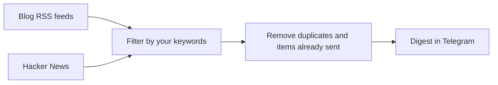

# Trend Radar

A daily news radar for marketers. Every morning it reads the blogs you follow and Hacker News, keeps only the items that match your keywords, removes duplicates and anything you have already seen, and sends a short digest to Telegram.

It runs on GitHub Actions, so it works while your laptop is closed. It uses only the Python standard library: nothing to install, no paid API.



## Why this exists

Keeping up with a niche usually means opening the same ten tabs every morning and skimming past noise. The radar does the opening and skimming, and you only read what matches the topics you care about. Exclusion words (like `sponsored` or `webinar`) cut the obvious noise.

## What the digest looks like

This is the output of the demo, built from two fictional sample feeds (`sample_rss.xml`, `sample_atom.xml`):

```
Trend radar, 19 Nov 2026
4 new items matching your keywords

1. AI search is changing how B2B content gets found
   Another Demo Feed (fictional) | keywords: B2B, AI search
   https://example.org/ai-search-b2b

2. How product marketing teams test positioning with five customer calls
   Synthetic Demo Blog (fictional) | keywords: product marketing, positioning
   https://example.com/positioning-calls
...
```

Items with more matching keywords come first. The radar sends titles and links only. It does not copy article text.

## Set it up (about 15 minutes, no coding)

### 1. Create a Telegram bot
1. In Telegram, open **@BotFather**, send `/newbot` and follow the steps.
2. BotFather gives you a **token**. Treat it like a password.
3. Open your new bot and send it any message (for example "hi").
4. In a browser, open `https://api.telegram.org/bot<YOUR_TOKEN>/getUpdates` (replace `<YOUR_TOKEN>`). Find `"chat":{"id":` followed by a number. That number is your **chat id**.

### 2. Add the secrets to GitHub
In this repository: **Settings > Secrets and variables > Actions > New repository secret**. Add two secrets:
- `TELEGRAM_BOT_TOKEN`: the token from BotFather
- `TELEGRAM_CHAT_ID`: the number from step 1

Never put the token in a file in the repository.

### 3. Choose your sources and keywords
- `feeds.txt`: one RSS or Atom feed URL per line. Competitor blogs work well here.
- `keywords.txt`: one keyword or phrase per line. Lines starting with `-` are exclusions.

### 4. Run it
Go to the **Actions** tab, open **Trend radar**, click **Run workflow**. After that it runs every day by itself (the time is set in `.github/workflows/radar.yml`, in UTC).

## Try it on your computer

```
python radar.py --demo       # fictional feeds, no internet needed
python radar.py --dry-run    # real feeds, prints the digest instead of sending it
python -m unittest
```

Useful options: `--hours 24` (only items from the last 24 hours, default 48), `--max-items 5`, `--no-hn`.

## How it works

1. Reads each feed and parses RSS or Atom. A broken feed is skipped with a warning, it does not stop the run.
2. Searches Hacker News for each keyword (public search API by Algolia). Only stories with the keyword in the title are kept.
3. Keeps items that contain at least one keyword as a whole word and no exclusion word.
4. Removes duplicates: the same link with tracking parameters (`utm_` and similar) or the same title from two sources.
5. Skips links sent in the last 30 days. The list is stored in `seen.json`, which the workflow commits back to the repository after each run.

## What was tested, and what was not

- **Tested** (14 automated tests, see `test_radar.py`): RSS and Atom parsing, Hacker News response parsing, keyword and exclusion matching, duplicate removal, the 48-hour window, the "already sent" memory, the Telegram length limit, and a full run with the network replaced by sample files.
- **Not tested live**: the development environment had no internet access, so real feeds, the Hacker News API and actual Telegram delivery were not tested there. The seven feeds in `feeds.txt` were checked by hand on 19 Nov 2026 and returned RSS 2.0. If something fails on the first run, the Actions log shows which source.

## Limits and things to know

- GitHub runs scheduled workflows on a best-effort basis, so the digest can arrive later than the set time.
- In a public repository, GitHub disables scheduled workflows after 60 days without repository activity ([GitHub docs](https://docs.github.com/en/actions/managing-workflow-runs-and-deployments/managing-workflow-runs/disabling-and-enabling-a-workflow)). If the radar stops, re-enable it in the Actions tab.
- Standard GitHub-hosted runners are free in public repositories ([GitHub docs](https://docs.github.com/en/billing/managing-billing-for-your-products/managing-billing-for-github-actions/about-billing-for-github-actions)). Check the current terms before using a private repository.
- Keyword matching is literal. It does not understand meaning, so pick specific phrases and use exclusions for noise.
- Use public feeds and respect each site's terms. Reddit is not included: its API and RSS access have been restricted.

## Measuring the time it saves

I am not claiming any savings. To measure your own:

| Task | Time by hand | Time with the radar |
|---|---|---|
| Daily scan of [N] sources | [your measured time] | [your measured time] |

## Built with AI assistance

This project was built with help from an AI assistant and reviewed and tested by the author.

## Ideas for next versions

- Send to Slack or email instead of Telegram
- A weekly summary of the most frequent keywords
- Separate sections for competitors and for industry news

---

Made by Yelyzaveta Vasylenko. B2B content and product marketer. [LinkedIn](https://www.linkedin.com/in/yelyzaveta-vasylenko-111abc)
